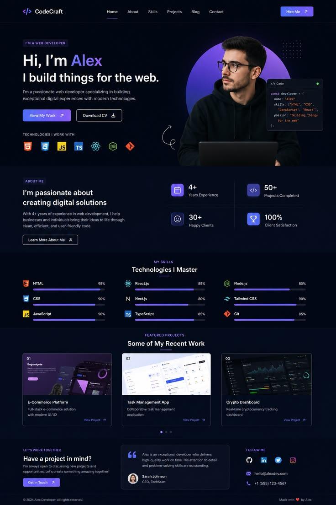
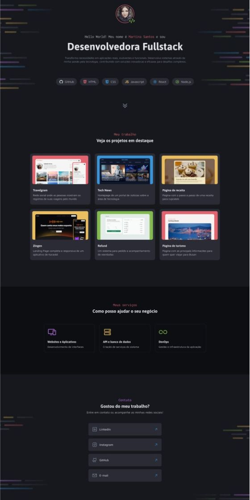
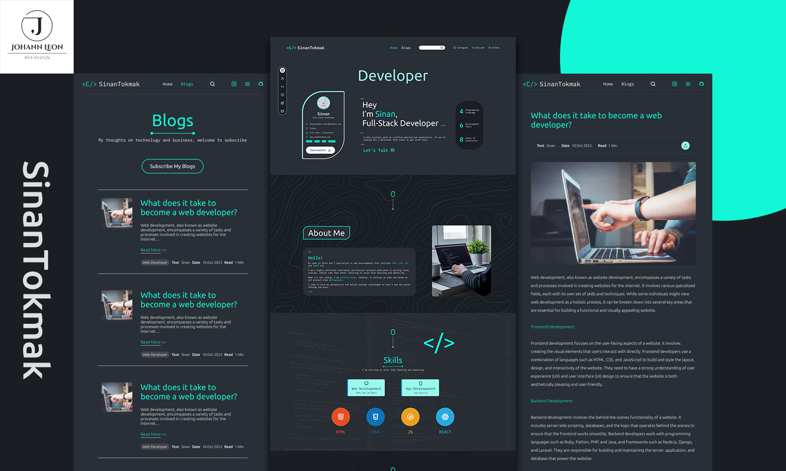
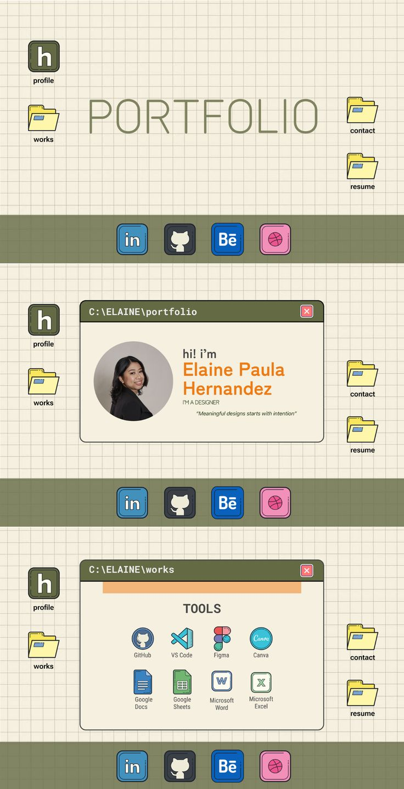
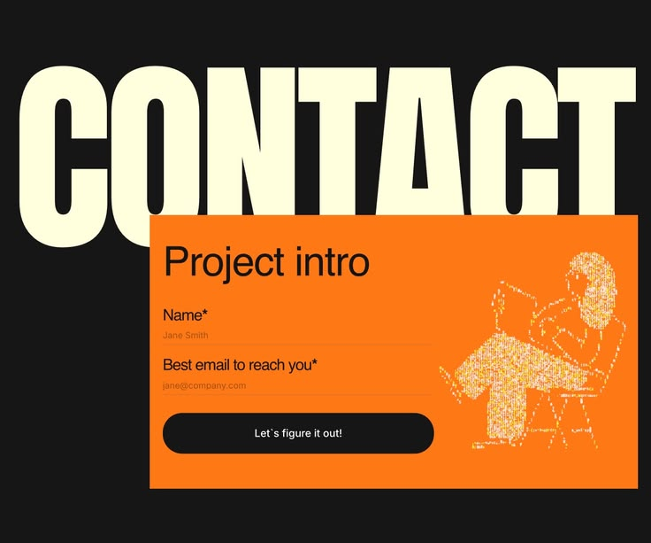

# Construindo Portfolio com IA

## Prompt Inicial
Preciso que faça um projeto em html com tailwind. Ele consiste em um portfólio dev interessante, claro e que chame a atenção para as skills.
Sobre mim, sou desenvolvedora fullstack e estudante de engenharia de software.

## Sobre mim
Gosto muito de tecnologia, comunicação e aprender coisas novas.
Tech Stack
- TypeScript / JavaScript 90%
- Node.js / NestJS 85%
- Next.js / React 85%
- Python 80%
- SQL / Prisma ORM 80%
- MongoDB 75%
- Java 65%

---
## Decisões de identidade visual
Paleta de cores:

| Papel | Hex | Uso no site |
|---|---|---|
| Fundo (`ink`) | `#0A0614` | Fundo da página |
| Superfície (`panel`) | `#130B26` | Cards, caixas de diálogo, painéis |
| Texto (`fg`) | `#EDE9FE` | Texto principal e títulos |
| Violeta 400 | `#A78BFA` | Textos e ícones secundários |
| Violeta 500 | `#8B5CF6` | Bordas das caixas pixel |
| Violeta 700 | `#5B21B6` | Sombras duras e divisórias |
| Ciano | `#22E5FF` | Interação, links, HUD, hover |
| Verde neon | `#39FF14` | Progresso (XP), CTA principal, conquistas desbloqueadas |

Tipografia: 
- Press Start 2P: fonte pixel, usada só em títulos, botões e rótulos curtos (HUD, HP/MP/XP, conquistas).
- IBM Plex Mono: monospace, usada no texto corrido (pesos 400, 500 e 700).

Tom e personalidade:
- Tech / Criativa / Intensa

Estrutura da página:
- Hero
- Sobre mim
- Stack tecnológica
- Projetos
- Contato

---
## Referências

Manter a ideia de colocar a porcentagem de conhecimento de cada tech stack.

Manter as referências para links no github (3 destaques com título e imagem)

Manter o clima da imagem dev, entretanto, alterando a cor para as referenciadas

Manter estética criativa, mais gameficada

Manter seção de contato

---

## Prompts
### #1
"Quero criar um portfólio pessoal como desenvolvedora Full Stack e estudante de Engenharia de Software, usando HTML e Tailwind CSS.

Quero que o site tenha uma identidade visual bem marcante, moderna e criativa, fugindo um pouco daquele estilo de portfólio genérico. Gosto de tecnologia, comunicação e de estar sempre aprendendo coisas novas, então queria que isso também aparecesse na personalidade do site.

A ideia é seguir uma estética dark, com tons de roxo e lilás, usando principalmente as cores #0D0B14, #C4B5FD, #A78BFA, #7C3AED e #F5F3FF. Para a tipografia, quero usar Cantarell.

Quero uma vibe meio futurista, com referências a interfaces de jogos, elementos de programação e detalhes que deixem a experiência mais interessante, mas sem perder o profissionalismo. Algo criativo, intenso e tecnológico, com animações sutis, efeitos de hover e uma boa combinação entre espaços vazios, tipografia e elementos visuais.

A página deve ter uma seção inicial que apresente quem sou, com uma frase de impacto e links para explorar meus projetos ou entrar em contato. Depois, quero uma parte sobre mim, uma seção de tecnologias e habilidades, uma área para mostrar meus principais projetos e, por fim, uma seção de contato.

Na parte de skills, quero manter a ideia da referência que mostra as tecnologias com porcentagens de conhecimento. Minha stack inclui NestJS, Next.js, Python, MongoDB, TypeScript, JavaScript, Node.js, Java, SQL e Prisma.

Na seção de projetos, quero destacar três projetos com imagens, títulos e links para o GitHub, seguindo a ideia da referência que enviei. Como ainda vou definir alguns conteúdos, pode deixar espaços fáceis de editar para adicionar as informações depois.

Também quero manter a proposta visual das referências de tema, gamificação e contato que estão na pasta references/. Use essas imagens como inspiração para criar algo com a mesma atmosfera, adaptando tudo à minha paleta de cores e à identidade do site.

Quero que o resultado seja bonito, mas também funcional e responsivo, funcionando bem tanto no computador quanto no celular. A navegação deve ser simples, e o site precisa ter uma boa experiência de uso.

No geral, quero que meu portfólio transmita a imagem de uma desenvolvedora criativa, que gosta de tecnologia e se preocupa com os detalhes. Quero algo com personalidade, que chame a atenção de quem visita e destaque minhas habilidades sem ficar exagerado ou visualmente poluído.

Pode explorar ideias de layout e composição, mantendo essa direção visual como base. O mais importante é que o resultado tenha identidade própria e pareça realmente pensado para mim, em vez de ser apenas mais um template de portfólio."

### #2
Problema	
- O layout gerado ficou genérico e idêntico aos portfólios padrões criados por IA (Dark Mode simples, blocos estáticos). Faltaram os elementos gamificados, interatividade real (como HUD de jogo, barras de XP animadas, conquistas/achievements desbloqueáveis) e animações dinâmicas (efeito pixel art, retro-gaming ou micro-interações hover).

Prompt de correção
- "Ajuste o código HTML/Tailwind para afastar o design do padrão genérico de IA e criar um portfólio verdadeiramente gamificado e interativo. Adicione: 1) Um HUD / card estilo RPG de personagem com Status (HP, MP, Nível de Dev); 2) Barras de skill que pareçam barras de XP com efeito de carregamento em CSS; 3) Seção de conquistas (Achievements) desbloqueáveis ao passar o mouse ou clicar; 4) Animações suaves em Tailwind/CSS (efeito scanline de CRT ou iluminação neon retro); 5) Troque o esquema de cores para um estilo retrô-arcade ou cyber-RPG com paleta em tons de violeta, ciano e verde neon com fontes em estilo pixel/monospace."

Resultado	
- Resolveu totalmente. A estrutura passou de uma página corporativa simples para uma experiência imersiva de RPG/Arcade, destacando a criatividade e tornando o portfólio memorável.

Aprendizado	
- No prompt inicial, não basta citar "estética gamificada" de forma genérica. É necessário especificar quais mecânicas de jogo devem ser implementadas no front-end (ex.: status de RPG, badges de conquistas, animações CSS de barra de XP, paleta de cores retrô/arcade e fontes pixel/mono).

### #3
Problema	
- O layout apresentava blocos de texto puros e placeholders vazios (ex.: [ Imagem ]), sem ícones representativos para as tecnologias (ex.: React, NestJS, Python) e sem nenhum elemento gráfico ou avatar personalizado que desse personalidade ao portfólio.

Prompt de correção	
- "Adicione ícones correspondentes ao lado de cada tecnologia na seção de Tech Stack; Adicione uma moldura / card estilizado com bordas arredondadas e efeito de brilho para a foto de perfil/avatar no Hero;"

Resultado	
- O portfólio deixou de parecer um modelo genérico e passou a ter uma identidade rica, visualmente rápida de escanear e com cara de produto finalizado.

Aprendizado	
- Para que uma interface web não pareça um rascunho, o prompt inicial deve exigir a integração explícita de uma biblioteca de ícones SVG e a inclusão de componentes visuais estilizados (avatares, tags e ícones funcionais em botões/links).